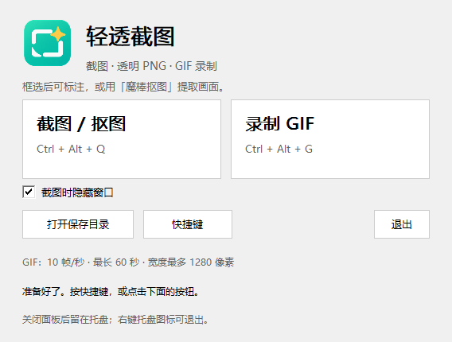
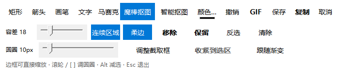

<p align="center">
  
</p>

<h1 align="center">QingTou <sub>轻透截图</sub></h1>

<p align="center">Lightweight capture · Built-in cutouts · Background-free PNG · GIF recording</p>

<p align="center">
  <a href="README.md">简体中文</a> · <strong>English</strong>
</p>

<p align="center">
  
  
  <a href="LICENSE"></a>
  
</p>

<p align="center">
  <a href="#download-and-run">Download and run</a> ·
  <a href="docs/USAGE.en.md">User guide</a> ·
  <a href="docs/BUILDING.md#english">Build from source</a> ·
  <a href="CONTRIBUTING.md#english">Contribute</a>
</p>

---

**QingTou** is a lightweight, portable native Windows tool for screenshots, annotations, built-in cutouts, and GIF recording. Capture a region, sweep a circular brush to extract a logo or icon, and export a **background-free transparent PNG** for documents, presentations, or design layouts. Trim the extra space around the subject in one click.

No sign-in is required. Image processing happens on your computer. The interface follows the Windows light/dark app setting with neutral system colors. **The app interface is currently Chinese; the documentation is available in Chinese and English.**

## Why QingTou

| Feature | What you get |
| --- | --- |
| **Lightweight and portable** | The current local x64 executable is about **1.4 MiB**. Run it directly after downloading or extracting; no installation is needed. |
| **Cutouts during capture** | Select a region and extract logos, icons, buttons, or other assets in the same capture interface. |
| **Background-free PNGs** | Keep the subject or remove the background, then export a PNG with alpha transparency to place over other backgrounds. |
| **Trim extra space** | Resize the capture frame after a cutout, or use **收紧到选区** (Trim to content) to fit the canvas to the subject. |
| **Everyday tools together** | Capture, annotate, make cutouts, and record region GIFs, with global hotkeys and tray access. |
| **Local image processing** | Capture and cut out images on your computer, without registering an account or uploading images. |

<sub>File size refers to the current local 0.9.1 x64 build and may vary by version and toolchain. Cutouts use color-based selection; see Current limitations below for complex subjects.</sub>

<p align="center">
  <picture>
    <source media="(prefers-color-scheme: dark)" srcset="docs/interface-dark.png">
    
  </picture>
</p>

## What it does

| Screenshots | Transparent PNG | Region GIF |
| --- | --- | --- |
| Select a region; add rectangles, arrows, pen strokes, text, or mosaic | Drag to select colors, add/subtract regions, preserve transparency, trim blank space | Record a region; stop with a hotkey; save and copy the file |

- **Color-based cutout**: select similar colors in flat backgrounds, mild gradients, shadows, and compression noise.
- **Continuous selection**: hold the left mouse button and sweep a circular brush. Undo a whole stroke in one step.
- **Tight output bounds**: drag the blue capture border directly or fit the PNG canvas to selected content.
- **Real transparency**: PNG saving and copying preserve alpha. The checkerboard and selection tint are preview-only.
- **Quick access**: system tray, configurable global hotkeys, hide-on-capture, and single-instance operation.
- **Native stack**: C++20, Win32, Direct2D / DirectWrite, and Windows WIC; no external image-processing service is needed.

## Download and run

**The source is currently at preview version `0.9.1`. The first GitHub Release has not been published yet.** Windows packages will be available on the [Releases page](https://github.com/HaoranSun1122/QingTou_PrintScreen/releases). You can also [build from source](docs/BUILDING.md#english).

1. Download the Windows x64 archive and extract it to a writable folder.
2. Run `QingTou.exe`. Running the app does not require a compiler or Python.
3. Exit the old instance from the tray before replacing files during an update.

Targets **SDR desktops on Windows 10 version 2004+ and Windows 11**. Closing the panel keeps the app in the tray; right-click its tray icon to exit. Settings are stored in `QingTou.ini` beside the executable, and GIFs are saved to `captures/` by default.

## Make a transparent PNG in three steps

**Capture → Select content → Trim and save**

1. Press `Ctrl + Alt + Q`, select a region containing the logo, and activate **魔棒抠图** (color cutout).
2. Sweep the circle inside the subject, or click its different colors to accumulate a selection. Hold `Alt` to subtract; press `Ctrl + Z` to undo.
3. Click **保留** (Keep), then **收紧到选区** (Trim to content), and save the PNG. Saving with an unapplied selection also keeps the selected content.



Alternatively, select a background and click **移除** (Remove). Circle size and tolerance control brush coverage and color matching independently. See the [full user guide](docs/USAGE.en.md) for the interface label map and more examples.

## Keyboard shortcuts

| Action | Shortcut |
| --- | --- |
| Screenshot / cutout | `Ctrl + Alt + Q` |
| Start / stop GIF | `Ctrl + Alt + G` |
| Color cutout tool | `W` |
| Copy / save PNG | `Enter` / `Ctrl + S` |
| Undo a click or a whole brush stroke | `Ctrl + Z` |
| Subtract / replace selection | `Alt + click or drag` / `Ctrl + click or drag` |
| Change circle size | Circle slider, mouse wheel, `[` / `]` |
| Exit the current capture | `Esc` |

## Current limitations

- Selection uses color and connectivity. Similar foreground/background colors, strong shadows, complex photos, hair, and glass can require manual additions or subtraction.
- GIFs have no audio. The target is 10 fps, up to 60 seconds, with a maximum width of 1280 px. Actual frame rate depends on content and hardware.
- Some apps discard alpha when pasting. Save a PNG and import it as a file if that happens.
- HDR, remote desktop, protected content, and mixed-DPI multi-monitor configurations need further validation.

## Development and contributions

```powershell
.\build.ps1
```

Requires Windows, CMake 3.20+, and a C++20 toolchain. Default tests do not read the user's desktop. Desktop capture tests are enabled separately.

[Build and test](docs/BUILDING.md#english) · [Contributing](CONTRIBUTING.md#english) · [Changelog](CHANGELOG.md) · [Publishing](docs/PUBLISHING.md#english)

When reporting a bug, include your Windows version, display scaling, app version, and reproduction steps. The [issue templates](https://github.com/HaoranSun1122/QingTou_PrintScreen/issues/new/choose) include these fields. Remove private information from screenshots. See [SECURITY.md](SECURITY.md#english) for security reporting.

## License and assets

Project code, documentation, and the brand assets supplied in this repository are distributed under the [MIT License](LICENSE). Third-party components retain their own terms; see [THIRD_PARTY_NOTICES.md](THIRD_PARTY_NOTICES.md). See the [asset notes](resources/brand/README.md) for icon provenance and regeneration instructions.
