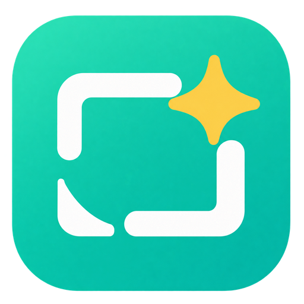
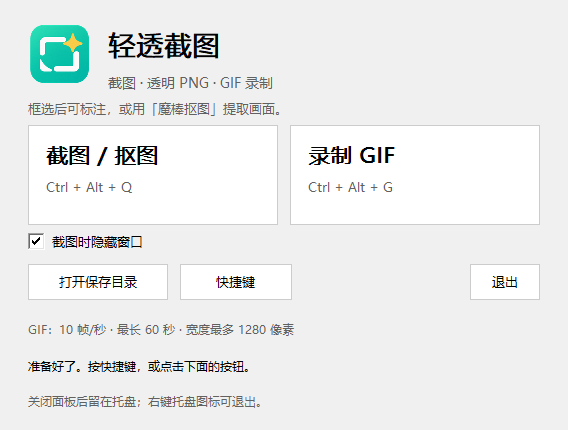
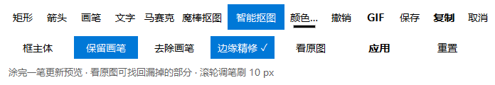
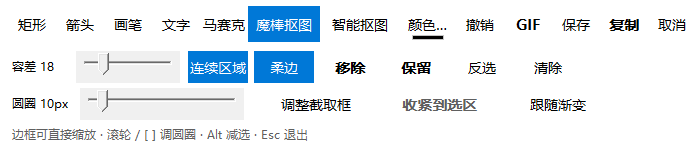

<p align="center">
  
</p>

<h1 align="center">轻透截图 <sub>QingTou</sub></h1>

<p align="center">轻量截图 · 直接抠图 · 无背景透明 PNG · GIF 录制</p>

<p align="center">作者：<strong>Dr. Sun Haoran</strong> · Shenzhen Polytechnic University</p>
<p align="center"><strong>Dr. Chen Zijie</strong> · Macau University of Science and Technology</p>
<p align="center"><strong>Mr. Leo</strong></p>


<p align="center">
  <strong>简体中文</strong> · <a href="README.en.md">English</a>
</p>

<p align="center">
  
  
  <a href="LICENSE"></a>
  
</p>

<p align="center">
  <a href="https://github.com/HaoranSun1122/QingTou_PrintScreen/releases/download/v0.9.2/QingTou.exe"><strong>下载 EXE（0.9.2）</strong></a> ·
  <a href="#下载与运行">下载与运行</a> ·
  <a href="docs/USAGE.md">使用指南</a> ·
  <a href="docs/BUILDING.md">从源码构建</a> ·
  <a href="CONTRIBUTING.md">参与贡献</a>
</p>

---

**轻透截图**是一个轻量、便携的原生 Windows 截图工具，集截图、标注、直接抠图和 GIF 录制于一体。框选后即可用圆形笔刷提取 Logo、图标等内容，去掉背景，导出可用于文档、演示和设计排版的**无背景透明 PNG**，再把四周多余空白一键收紧。

不需要登录，图像处理在本机完成。界面使用系统中性色，跟随 Windows 应用浅色 / 深色设置；当前软件界面为中文，项目文档提供中英文版本。

> **0.9.6 待发布：智能抠图与截图体验升级。** 新增框选主体、保留 / 去除画笔、边缘精修和窗口预选，增强文字、颜色与马赛克工具，并改善大图细线保留。下方公开下载仍为 **0.9.2 Preview，不包含本次新增功能**。查看 [0.9.6 发行说明](docs/releases/v0.9.6.md) · [完整更新记录](CHANGELOG.md)。

## 为什么选择轻透截图

| 特点 | 带来的便利 |
| --- | --- |
| **轻量便携** | 当前本地 x64 构建的单个 EXE 约 **1.5 MiB**，无需安装，下载或解压后即可运行。 |
| **截图时直接抠图** | 框选画面后，在同一个截图界面选取并提取 Logo、图标、按钮等素材。 |
| **智能提取与修补** | 框住主体估计背景，再用保留 / 去除画笔修补，适合渐变背景上的 Logo。 |
| **真正的无背景 PNG** | 保留主体或移除背景，导出带 Alpha 透明通道的 PNG，方便叠放到不同背景上。 |
| **一键裁掉多余空白** | 抠图后继续调整截图框，或点「收紧到选区」，让图片画布贴合主体。 |
| **常用操作集中完成** | 截图、标注、抠图和区域 GIF 录制，配合全局快捷键与托盘入口随手调用。 |
| **图片在本机处理** | 截图与抠图在本地完成，无需注册账号或上传图片。 |

<sub>文件体积以当前本地 x64 构建为参考，可能随版本与编译方式变化。抠图基于颜色选取，复杂素材的适用范围见下方「当前边界」。</sub>

<p align="center">
  <picture>
    <source media="(prefers-color-scheme: dark)" srcset="docs/interface-dark.png">
    
  </picture>
</p>

## 能做什么

| 日常截图 | 透明 PNG | 区域 GIF |
| --- | --- | --- |
| 框选、矩形、箭头、画笔、文字、马赛克、撤销 | 圆形拖选、多次累积、Alt 减选、透明导出、裁掉空白 | 框选录制、快捷键停止、自动保存并复制为文件 |

- **魔棒抠图**：按相似颜色选取，可处理近似纯色背景和轻度渐变、阴影、压缩杂色。
- **智能抠图**：框选主体，查看透明预览，用保留 / 去除画笔修补，可切换原图和边缘精修。
- **窗口预选**：鼠标悬停高亮窗口，单击确认；桌面空白处预选显示器，也支持自由拖框。
- **标注增强**：8–144 px 可编辑文字、自定义 RGB 颜色、4–64 px 马赛克，画笔增量显示。
- **连续涂选**：按住左键拖动圆圈，经过的颜色扩展为相似区域；一笔可整体撤销。
- **收紧到选区**：选好内容后直接拖蓝色边框裁切，或一键让 PNG 画布贴合主体。
- **保留透明度**：PNG 保存与复制保留 Alpha；棋盘格和蓝色选区只用于预览。
- **随手调用**：系统托盘、自定义全局快捷键、截图时隐藏窗口、单实例运行。
- **原生实现**：C++20、Win32、Direct2D / DirectWrite、Windows WIC，无需额外图像处理服务。

## 下载与运行

**当前源码与本地构建为 `0.9.6`，尚未发布到 GitHub。** 下方公开下载为 `0.9.2 Preview`；[查看全部已发布版本](https://github.com/HaoranSun1122/QingTou_PrintScreen/releases)。

1. **直接下载 [QingTou.exe](https://github.com/HaoranSun1122/QingTou_PrintScreen/releases/download/v0.9.2/QingTou.exe)，双击即可使用，无需安装或编译。**
2. 将 EXE 放在有写入权限的文件夹，方便保存设置和录制的 GIF。
3. 更新前先从托盘退出旧版，再用新版 EXE 替换原文件；保留原有 `QingTou.ini` 即可继续使用已有设置。

也可以下载[完整便携 ZIP](https://github.com/HaoranSun1122/QingTou_PrintScreen/releases/download/v0.9.2/QingTou-v0.9.2-windows-x64.zip)，其中另含使用指南、许可证和第三方声明。`Source code` 与 `*-source.zip` 为开发者提供源码；自行编译请参考[构建指南](docs/BUILDING.md)。

面向 **Windows 10 2004+ / Windows 11 的 SDR 桌面**。关闭主面板后软件留在托盘，右键托盘图标可以退出。设置保存在 exe 旁的 `QingTou.ini`，GIF 默认保存在 `captures/`。

## 三步做一张透明 PNG

**智能抠图：框选主体 → 修补 → 应用并保存**

1. 截图后点「智能抠图」，拖框圈住完整主体，让框外留一些背景样本。
2. 用「保留画笔」补回漏掉的内容，用「去除画笔」涂掉残留背景；滚轮调大小，`Ctrl + Z` 撤销。
3. 查看「边缘精修」效果，点「应用」，再用「收紧到选区」裁掉空白并保存 PNG。



也可以继续使用原来的魔棒方式：

**框选 → 魔棒抠图 → 收紧并保存**

1. 按 `Ctrl + Alt + Q` 框选包含 Logo 的画面，打开「魔棒抠图」。
2. 沿主体内部拖动圆圈，或依次点击不同颜色，累计选中所需部分。误选时用 `Alt` 减选，`Ctrl + Z` 撤销。
3. 点「保留」去掉背景，再点「收紧到选区」裁掉透明空白，最后保存 PNG。选区尚未应用时，直接保存也会保留所选部分。



也可以点击背景后选择「移除」。圆圈大小与容差分别控制涂选范围和颜色匹配；详情见[完整使用指南](docs/USAGE.md)。

## 常用快捷键

| 操作 | 快捷键 |
| --- | --- |
| 截图 / 抠图 | `Ctrl + Alt + Q` |
| 开始 / 停止 GIF | `Ctrl + Alt + G` |
| 魔棒抠图 | `W` |
| 复制 / 保存 PNG | `Enter` / `Ctrl + S` |
| 撤销一次选点或整笔涂选 | `Ctrl + Z` |
| 减选 / 重新选择 | `Alt + 点击或拖动` / `Ctrl + 点击或拖动` |
| 调整圆圈大小 | 「圆圈」滑条、滚轮、`[` / `]` |
| 退出当前截图 | `Esc` |

## 当前边界

- 抠图依据颜色和连通性。主体与背景同色、强阴影、复杂照片、发丝、玻璃等仍可能需要手动追加 / 减选。
- 智能抠图需要背景样本；全图框选时应使用去除画笔标记背景。大图细节恢复优先适用于能可靠估计的平滑渐变，复杂纹理仍建议收紧主体框并手动修补。
- GIF 不含声音，目标 10 帧/秒，最长 60 秒，宽度最多 1280 像素；实际帧率受画面与设备性能影响。
- 部分软件粘贴图片时会丢失透明度，遇到这种情况请保存 PNG 后以文件方式导入。
- HDR、远程桌面、受保护内容和混合 DPI 多屏仍需进一步验证。

## 开发与贡献

```powershell
.\build.ps1
```

需要 Windows、CMake 3.20+ 和 C++20 工具链。默认测试不读取用户桌面；桌面采集测试单独启用。

[构建与测试](docs/BUILDING.md) · [贡献指南](CONTRIBUTING.md) · [更新记录](CHANGELOG.md) · [发布指南](docs/PUBLISHING.md)

发现问题时，请提交 Windows 版本、缩放比例、软件版本和复现步骤；[问题反馈模板](https://github.com/HaoranSun1122/QingTou_PrintScreen/issues/new/choose)已包含这些字段。截图中请移除私人信息。安全问题请参考 [SECURITY.md](SECURITY.md)。

## 许可与资源

项目代码、文档及仓库内提供的品牌资源按 [MIT License](LICENSE) 发布。第三方组件保留其各自许可，见 [THIRD_PARTY_NOTICES.md](THIRD_PARTY_NOTICES.md)。图标来源和重新打包方式见[品牌资源说明](resources/brand/README.md)。
