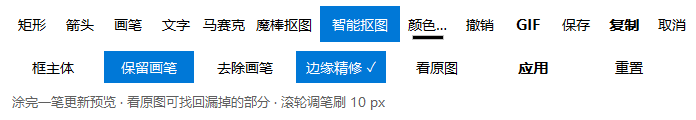
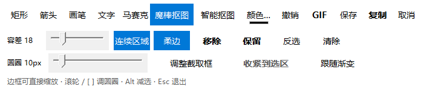

# User guide

[简体中文](USAGE.md) · **English** · [GitHub](https://github.com/HaoranSun1122/QingTou_PrintScreen)

The current app UI is Chinese. The table below maps the labels used in this guide.

| UI label | Meaning |
| --- | --- |
| 截图 / 抠图 | Screenshot / cutout |
| 魔棒抠图 | Color cutout tool |
| 智能抠图 | Guided subject cutout |
| 框选主体 / 保留画笔 / 去除画笔 | Subject box / Keep brush / Remove brush |
| 边缘精修 / 看原图 / 应用 | Edge refinement / original view / Apply |
| 跟随渐变 | Follow gradients in contiguous mode |
| 容差 / 圆圈 | Tolerance / circle diameter |
| 连续区域 / 全图相似 | Contiguous region / similar colors globally |
| 柔边 | Feather edges |
| 移除 / 保留 | Remove / keep selected content |
| 清除 / 反选 | Clear / invert selection |
| 收紧到选区 | Trim canvas to selected or nontransparent content |
| 调整截取框 / 完成调整 | Adjust capture frame / finish adjusting |
| 录制 GIF / 停止并保存 | Record GIF / stop and save |

## Run and locate files

Extract the Windows x64 package to a writable folder, then run `QingTou.exe`. A compiler, Python, and Pillow are not required to run the app.

| Data | Location |
| --- | --- |
| PNG | Chosen in the save dialog |
| GIF | `captures/` beside the executable |
| Hotkeys and hide-window preference | `QingTou.ini` beside the executable |

Closing the panel keeps the app in the tray. Its context menu provides capture, recording, the output folder, and Exit.

Hide-window-on-capture is enabled by default and applies to buttons, hotkeys, and tray commands. Cancelling restores the panel if it was previously visible.

## Take a screenshot

1. Press `Ctrl + Alt + Q`, hover to preselect a window, then click to confirm. Empty desktop areas select the monitor; hold and drag for a free region.
2. Add rectangles, arrows, pen strokes, text, or mosaic as needed. Use `Ctrl + Z` to undo.
3. Press `Enter` / `Ctrl + C` to copy, or `Ctrl + S` to save a PNG.

`Esc` exits the current capture in one step. Use Clear if you only want to reset the cutout selection and continue editing.

Preselection uses the desktop frozen when capture starts. Occluded windows contain the pixels actually visible at that time.

## Guided subject cutouts

1. After capturing, click **智能抠图** and box the whole subject, leaving some background outside the box.
2. Release to preview transparency. Use **保留画笔** (Keep) for missing subject pixels and **去除画笔** (Remove) for unwanted background. The result is recalculated after each stroke.
3. Adjust size with the wheel or `[` / `]`, and undo with `Ctrl + Z`. Compare the original using **看原图**, or toggle **边缘精修** to compare edge treatment.
4. Click **应用** (Apply), then resize/trim the capture frame and save. Copying or saving also applies a valid preview.

Processing stays on your computer. When boxing the entire image, provide background samples with Remove and foreground samples with Keep. An empty result leaves the original intact; add guidance before exporting.

Large images use a bounded segmentation grid. With a reliable smooth-gradient background, version 0.9.6 preserves thin foreground evidence inside cells and removes their background at original resolution. Complex textures, matching colors, and hair may still need tighter boxes and manual corrections.

## Text, colors, and mosaic

- Text sizes range from 8 to 144 px. Click an existing annotation in Text mode to edit its content, size, or color; hold `Ctrl` to create nearby text. Edits can be undone.
- **颜色…** and the text dialog open the system color picker with arbitrary RGB colors.
- The Mosaic slider ranges from 4 to 64 px. Larger blocks retain less detail; new regions use the current setting.
- Pen strokes show a dot on press and update incrementally. Undo removes a whole stroke.

## Transparent PNG and multicolor logos

### Select the subject

1. Capture the logo area and activate **魔棒抠图**, or press `W`.
2. Hold the left button and sweep the circle inside the subject. Colors under the circle expand into similar-color regions.
3. Plain clicks accumulate selection too, so you can select different colors or disconnected components individually.
4. Click **保留** (Keep). Saving or copying an unapplied selection also keeps the selected content first.

Blue tint and dashed boundaries indicate selected pixels. The checkerboard indicates transparency. These previews are not exported.

### Select the background

Click a background, then click **移除** (Remove) or press `Delete`. For similar foreground/background colors, lower tolerance and add small selections carefully.

### Refine selection

| Input | Result |
| --- | --- |
| Click / left-button drag | Add color regions |
| `Alt + click or drag` | Subtract regions |
| `Ctrl + click or drag` | Replace the old selection |
| `Ctrl + Z` | Undo the latest click or a whole stroke |
| Clear | Reset the selection while staying in the editor |
| Invert | Invert the selection of visible pixels |

Modifiers are captured when the left button is pressed. Strokes that do not change the selection do not add an undo step.

- **Circle**: 10 px by default, adjustable from 2 to 128 px using the size slider, mouse wheel, or `[` / `]`. The size stays fixed during a stroke.
- **Tolerance**: 18 by default. Increase it to accept more color variation; decrease it to reduce unwanted selection. Changes recompute the existing selection.
- **Follow gradients**: expands the seed-color range in contiguous mode while respecting detected edges. It is off by default; weak boundaries or similar foreground colors may need lower tolerance or subtraction.
- **Contiguous**: uses four-way connectivity and local edge checks to reduce leakage through pale outlines or diagonal contacts.
- **Global**: toggle the contiguous button to match similar colors throughout the capture area.
- **Feather**: enabled by default, softening inside the retained region. Turn it off for pixel art.

At tolerance 100, all nontransparent colors are accepted without local edge restrictions. Complex photos, hair, glass, strong shadows, and matching foreground/background colors may still need manual refinement.

## Trim blank space

After selecting content, drag the blue capture border or its eight handles directly. The subject keeps its original pixel size; PNG dimensions follow the capture frame.

Click **收紧到选区** to fit the frame to selected content. After Keep has been applied, the same button trims by nontransparent pixels. Interior holes and edge alpha remain transparent. The button is disabled if there is no useful content or no outer space to trim.

To move the whole capture frame, click **调整截取框**, drag inside, then click **完成调整**. Existing selections and annotations stay anchored to the original screen pixels. Newly revealed areas are not automatically added to old selections. Expanding back to the previous area restores selections hidden by a temporary crop.

## Record a GIF

1. Press `Ctrl + Alt + G`, or choose Record GIF.
2. Drag a region; recording starts on release.
3. Press the recording hotkey again, or choose Stop and save.

The GIF is saved to `captures/` and copied as a file. You can paste it into apps that accept file pastes. Recording can also be started from the screenshot toolbar.

The target rate is 10 fps, with a 60-second limit and a maximum width of 1280 px. Audio is not recorded. Actual frame rate depends on content and hardware.

## Shortcuts

| Action | Shortcut |
| --- | --- |
| Screenshot / cutout | `Ctrl + Alt + Q` |
| Start / stop GIF | `Ctrl + Alt + G` |
| Copy / save | `Enter` / `Ctrl + C` / `Ctrl + S` |
| Undo | `Ctrl + Z` |
| Rectangle / arrow / pen / text / mosaic | `R` / `A` / `P` / `T` / `M` |
| Cutout / remove selected content | `W` / `Delete` |
| Circle size | Slider, wheel, `[` / `]` |
| Exit the current capture | `Esc` / right-click |

Configure global shortcuts from the main panel. Command-line entries: `QingTou.exe --capture`, `--gif`, and `--tray`.

## Troubleshooting

**Transparency is black or white after pasting.** Some receiving apps discard alpha. Save the PNG and import it as a file.

**Saving or settings fail.** Use a writable extraction folder and check whether a file is in use. Exit the old instance from the tray before updating.

**A global shortcut does not work.** Another app may have registered it. Choose a different combination from the main panel.

**Does Esc quit the whole app?** Esc ends capture editing. The app can remain in the tray; use the tray menu to fully exit.

**Are captures uploaded?** The current app has no upload, telemetry, or auto-update feature. Your clipboard, synced folders, and other apps may have their own synchronization behavior.

HDR, mixed-DPI monitors, remote desktop, and protected content need further validation. Report problems through the [issue templates](https://github.com/HaoranSun1122/QingTou_PrintScreen/issues/new/choose), with private information removed.
