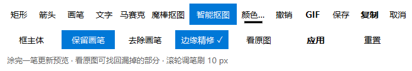
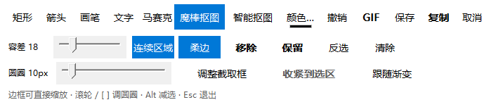

# 使用指南

**简体中文** · [English](USAGE.en.md) · [GitHub](https://github.com/HaoranSun1122/QingTou_PrintScreen)

## 运行与保存位置

解压 Windows x64 包后运行 `QingTou.exe`，放在有写入权限的目录中。使用软件不需要安装编译器、Python 或 Pillow。

| 内容 | 保存位置 |
| --- | --- |
| PNG | 保存对话框中选择的位置 |
| GIF | exe 旁的 `captures/` |
| 快捷键、截图时隐藏窗口设置 | exe 旁的 `QingTou.ini` |

主面板关闭后仍驻留系统托盘。右键托盘图标可打开面板、截图、录制 GIF、打开保存目录或退出。

「截图时隐藏窗口」默认勾选，按钮、快捷键和托盘入口共用设置；取消截图时恢复之前可见的主面板。

## 普通截图

1. 按 `Ctrl + Alt + Q`，鼠标悬停预选窗口，单击确认；桌面空白处预选当前显示器，也可直接按住左键自由拖框。
2. 按需添加矩形、箭头、画笔、文字或马赛克，`Ctrl + Z` 撤销。
3. 按 `Enter` / `Ctrl + C` 复制，或 `Ctrl + S` 保存 PNG。

`Esc` 一次退出当前截图。只想清空抠图选区、继续编辑时，请点工具栏「清除」。

预选使用触发截图时冻结的桌面画面，窗口被遮挡的部分按当时实际显示的内容截取。

## 智能抠图

1. 截图后点「智能抠图」，拖框圈住整个主体，在框外留下一些背景。
2. 松手查看透明预览。用「保留画笔」补回漏掉的主体，用「去除画笔」清除残留背景；每笔松手后重新计算。
3. 滚轮或 `[` / `]` 调整笔刷大小，`Ctrl + Z` 撤销最近一笔。可点「看原图」对照，或切换「边缘精修」比较边缘效果。
4. 点「应用」提交抠图，然后可调整截图框、收紧空白并保存。直接复制 / 保存也会应用有效预览。

算法全程在本机运行。全图框选没有框外背景时，先用去除画笔标记背景，再用保留画笔标记主体。结果为空时会保留原图，继续补充标记后再导出。

大图使用有限分辨率的分割网格；在可靠的平滑渐变背景上，0.9.6 会保留网格内的细线证据，并按原图颜色去掉网格中的背景。复杂纹理、同色主体、发丝等仍可能需要收紧主体框并人工修补。

## 文字、颜色与马赛克

- 「文字」支持 8–144 px 字号。文字模式下点击已有标注可改内容、字号和颜色；按住 `Ctrl` 点击可在附近新建文字。编辑可撤销。
- 「颜色…」和文字对话框可打开系统色板，选择任意 RGB 颜色。
- 「马赛克」下方滑条支持 4–64 px，块越大保留细节越少；新区域使用当时的设置。
- 「画笔」按下即显示笔点，拖动增量更新，`Ctrl + Z` 撤销整笔。

## 透明 PNG 与多色 Logo

### 选择主体

1. 框选包含 Logo 的画面，点「魔棒抠图」，也可按 `W`。
2. 沿 Logo 内部按住左键拖动圆圈；经过的颜色会扩展为相似区域。
3. 普通点击会追加选区，也可依次点选不同颜色或分散部分。
4. 点「保留」留下已选部分；或直接保存 / 复制，软件会先保留当前选区。

蓝色覆盖和虚线表示选中的部分，不会进入导出的图片；棋盘格表示透明。

### 选择背景

点击背景，再点「移除」或按 `Delete`。如果主体和背景颜色接近，先调低容差，再用多次点击或拖动补选。

### 操作与调整

| 操作 | 效果 |
| --- | --- |
| 单击 / 左键拖动 | 累积选择颜色区域 |
| `Alt + 点击或拖动` | 从已有选区减去经过的区域 |
| `Ctrl + 点击或拖动` | 清掉旧选区后重新选择 |
| `Ctrl + Z` | 撤销最近一次选点或整笔拖动 |
| 「清除」 | 清空当前选区，保留编辑界面 |
| 「反选」 | 反转当前可见像素的选择 |

修饰键在按下左键时确定本笔操作。没有改变选区的重复涂选不会多占一步撤销。

- **圆圈**：默认直径 10 px，范围 2–128 px。拖动大小滑条，或使用滚轮、`[` / `]` 同步调整。本笔拖动期间保持大小不变。
- **容差**：默认 18。调高可容忍更多颜色差异，调低可减少误选。修改后会重算现有选择。
- **跟随渐变**：仅作用于连续区域，放宽起点颜色差异范围；明显边界仍可阻挡选区。默认关闭，弱边界或前景近似色可能需要降低容差或减选。
- **连续区域**：沿上下左右选择，并检查局部轮廓，减少跨浅灰边框或对角接触处串区。
- **全图相似**：点击「连续区域」切换，选择整个截取范围中的相似颜色。
- **柔边**：默认开启，在保留部分的内侧柔化边缘。像素图可关闭。

容差 100 接受所有非透明颜色，不再限制局部边界。复杂照片、发丝、玻璃、强阴影和主体 / 背景同色的场景，仍可能需要人工补选或减选。

## 去掉四周空白

选好 PNG 内容后，可以直接拖动蓝色边框或八个控制点裁切。框内内容保持原像素大小，保存的 PNG 尺寸随框改变。

点「收紧到选区」可以一键贴合选中的内容；已经点过「保留」时，则按非透明像素裁掉四周透明空白。内部透明孔洞和边缘透明度保留。已无空白可收紧或没有可用内容时，按钮变灰。

需要移动整个截取范围时，点「调整截取框」，拖动框内区域，完成后点「完成调整」。已有选择和标注仍锚定在原画面位置；扩大后新增画面不会自动加入旧选区。临时缩小后再扩大到原范围，可恢复原来的选择。

## GIF 录制

1. 按 `Ctrl + Alt + G` 或点击「录制 GIF」。
2. 拖动框选区域，松开后开始录制。
3. 再按录制快捷键，或点「停止并保存」结束。

GIF 自动保存到 `captures/`，并复制为文件，可粘贴到支持文件粘贴的软件中。也可从截图工具栏进入 GIF 录制。

录制目标为 10 帧/秒，最长 60 秒，宽度最多 1280 像素，不含声音。实际帧率依画面和设备性能而定。

## 快捷键

| 操作 | 按键 |
| --- | --- |
| 截图 / 抠图 | `Ctrl + Alt + Q` |
| 开始 / 停止 GIF | `Ctrl + Alt + G` |
| 复制 / 保存 | `Enter` / `Ctrl + C` / `Ctrl + S` |
| 撤销 | `Ctrl + Z` |
| 矩形 / 箭头 / 画笔 / 文字 / 马赛克 | `R` / `A` / `P` / `T` / `M` |
| 魔棒抠图 / 移除当前选区 | `W` / `Delete` |
| 调整圆圈大小 | 滑条、滚轮、`[` / `]` |
| 退出当前截图 | `Esc` / 鼠标右键 |

全局快捷键可在主面板修改。命令行入口：`QingTou.exe --capture`、`--gif`、`--tray`。

## 常见问题

**粘贴后透明背景变黑或变白？** 部分接收软件不保留剪贴板 Alpha。保存 PNG，再以文件方式导入。

**保存或设置失败？** 确认解压目录可以写入，并检查文件是否被其他程序占用。更新前先从托盘退出旧版。

**热键不生效？** 可能已被其他软件占用，在主面板「快捷键」中更换组合。

**Esc 会退出整个软件吗？** 在截图编辑时，Esc 结束当前截图；主程序可继续在托盘运行。完全退出请使用托盘菜单。

**会上传我的截图吗？** 当前实现没有上传、遥测或自动更新功能。剪贴板、云盘目录和其他软件可能有各自的同步行为。

HDR、混合 DPI 多屏、远程桌面和受保护内容仍需进一步验证。遇到问题请使用 [Bug 模板](https://github.com/HaoranSun1122/QingTou_PrintScreen/issues/new/choose)，并移除截图里的私人信息。
